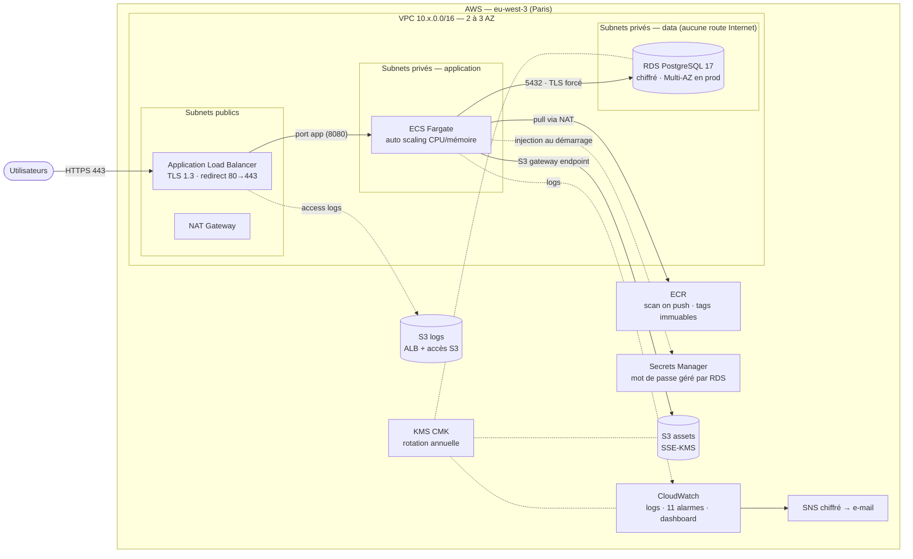

# Infrastructure as Code — Terraform AWS


Modules Terraform réutilisables pour provisionner une plateforme applicative complète sur AWS :
**VPC, ECS Fargate, RDS PostgreSQL, ALB, IAM roles et S3**. Le state est stocké à distance sur
**S3 avec verrouillage DynamoDB**. La sécurité est intégrée par défaut : **chiffrement at rest (KMS),
IAM au moindre privilège, Security Groups restrictifs et alerting CloudWatch**.

> Projet portfolio : il montre comment je conçois une infrastructure cloud de production :
> modulaire, sécurisée par défaut, observable, multi-environnement et vérifiée en CI.

---

## Sommaire

- [Architecture](#architecture)
- [Fonctionnalités](#fonctionnalités)
- [Structure du dépôt](#structure-du-dépôt)
- [Modules](#modules)
- [Prérequis](#prérequis)
- [Déploiement pas à pas](#déploiement-pas-à-pas)
- [Sécurité](#sécurité)
- [Observabilité et alerting](#observabilité-et-alerting)
- [CI/CD](#cicd)
- [Coûts estimés](#coûts-estimés)
- [Choix techniques](#choix-techniques)
- [Nettoyage](#nettoyage)
- [Pistes d'amélioration](#pistes-damélioration)

---

## Architecture



**Flux réseau autorisés (et rien d'autre) :**

| Source | Destination | Port | Règle |
|---|---|---|---|
| Internet (CIDR configurables) | ALB | 80 / 443 | 80 redirige vers 443 dès qu'un certificat est fourni |
| ALB (SG) | Tâches ECS (SG) | port app | référence de Security Group, pas de CIDR |
| Tâches ECS (SG) | RDS (SG) | 5432 | référence de Security Group |
| Tâches ECS | AWS APIs / registres | 443 | sortie via NAT (S3 via gateway endpoint) |
| RDS | — | — | **aucune sortie** |

Plus de détails : [docs/architecture.md](docs/architecture.md).

---

## Fonctionnalités

- **10 modules réutilisables** (`vpc`, `security-groups`, `alb`, `ecs-fargate`, `rds-postgres`, `iam`, `s3`, `ecr`, `kms`, `monitoring`), chacun avec ses variables typées et validées, ses outputs documentés et sans valeur codée en dur.
- **Remote state** : bucket S3 versionné, chiffré KMS, TLS obligatoire, accès public bloqué, avec verrouillage **DynamoDB** (PITR et chiffrement KMS), créé par une stack `bootstrap` dédiée.
- **Multi-environnement** : `dev` (optimisé coûts : 1 NAT, Fargate Spot, single-AZ) et `prod` (NAT par AZ, RDS Multi-AZ, HTTPS obligatoire, protection contre la suppression).
- **Sécurité par défaut** : chiffrement partout, IAM au moindre privilège, Security Groups chaînés, aucun secret dans le code ni dans le state.
- **Observabilité** : 11 alarmes CloudWatch, dashboard, Container Insights, VPC Flow Logs, logs RDS exportés, notifications SNS.
- **Résilience** : auto scaling, *deployment circuit breaker* avec rollback automatique, sauvegardes RDS, snapshot final.
- **Qualité** : `terraform fmt` / `validate`, **15 tests unitaires `terraform test`** (provider AWS mocké, sans compte AWS), TFLint, Checkov, hooks pre-commit, pipeline GitHub Actions avec plan via **OIDC** (aucune clé AWS stockée).

---

## Structure du dépôt

```text
.
├── bootstrap/                  # Backend distant : S3 + DynamoDB + KMS (+ rôle OIDC GitHub optionnel)
├── modules/
│   ├── kms/                    # Clé CMK + policy (CloudWatch Logs, alarmes → SNS)
│   ├── vpc/                    # VPC 3 tiers, NAT, endpoint S3, Flow Logs, SG par défaut verrouillé (+ tests/)
│   ├── security-groups/        # SG ALB → App → DB chaînés par référence (+ tests/)
│   ├── s3/                     # Bucket sécurisé générique (SSE, TLS only, lifecycle, logging)
│   ├── ecr/                    # Registre d'images (KMS, scan, tags immuables, lifecycle)
│   ├── alb/                    # ALB + target group + listeners HTTP/HTTPS
│   ├── iam/                    # Rôles ECS execution / task au moindre privilège
│   ├── ecs-fargate/            # Cluster, task definition durcie, service, auto scaling
│   ├── rds-postgres/           # PostgreSQL chiffré, TLS forcé, secret géré, monitoring
│   └── monitoring/             # SNS, alarmes CloudWatch, dashboard
├── environments/
│   ├── dev/                    # Composition des modules + tfvars dev (+ tests/)
│   └── prod/                   # Même composition, paramètres production (+ tests/)
├── docs/
│   ├── architecture.md
│   └── security.md
├── .github/workflows/terraform-ci.yml
├── .checkov.yaml  .tflint.hcl  .pre-commit-config.yaml
└── Makefile
```

---

## Modules

| Module | Rôle | Ressources principales |
|---|---|---|
| [`kms`](modules/kms) | Chiffrement at rest de l'environnement | `aws_kms_key` (rotation), alias, key policy |
| [`vpc`](modules/vpc) | Réseau 3 tiers multi-AZ | VPC, subnets public/app/data, IGW, NAT, routes, endpoint S3, Flow Logs |
| [`security-groups`](modules/security-groups) | Pare-feu applicatif | 3 SG + règles `aws_vpc_security_group_*_rule` |
| [`s3`](modules/s3) | Bucket sécurisé réutilisable | SSE-S3/KMS, versioning, public access block, policy TLS, lifecycle |
| [`ecr`](modules/ecr) | Registre d'images | dépôt KMS, scan on push, tags immuables, lifecycle |
| [`alb`](modules/alb) | Point d'entrée HTTP(S) | ALB, target group `ip`, listeners, access logs |
| [`iam`](modules/iam) | Identités des conteneurs | rôles execution/task, policies scopées par ARN |
| [`ecs-fargate`](modules/ecs-fargate) | Exécution de l'application | cluster, task definition, service, auto scaling |
| [`rds-postgres`](modules/rds-postgres) | Base de données | instance, subnet group, parameter group, monitoring |
| [`monitoring`](modules/monitoring) | Alerting | topic SNS, 11 alarmes, dashboard |

Exemple d'utilisation d'un module :

```hcl
module "rds" {
  source = "../../modules/rds-postgres"

  identifier         = "myapp-prod-postgres"
  instance_class     = "db.t4g.medium"
  multi_az           = true
  subnet_ids         = module.vpc.private_data_subnet_ids
  security_group_ids = [module.security_groups.db_security_group_id]
  kms_key_arn        = module.kms.key_arn
}
```

---

## Prérequis

| Outil | Version |
|---|---|
| [Terraform](https://developer.hashicorp.com/terraform/install) | ≥ 1.9 (testé avec 1.16) |
| [AWS CLI](https://aws.amazon.com/cli/) | v2, configurée (`aws configure` ou SSO) |
| Docker | pour construire et pousser l'image applicative |
| *Optionnel* : TFLint, Checkov, pre-commit, make | qualité et sécurité en local |

Le compte AWS utilisé doit disposer de droits d'administration pour le premier déploiement.

---

## Déploiement pas à pas

### 1. Créer le backend distant (une seule fois)

```bash
cd bootstrap
terraform init
terraform apply
terraform output -raw backend_config   # à copier à l'étape 2
```

Cette stack crée le bucket `iac-portfolio-tfstate-<account>-<region>`, la table `iac-portfolio-tf-locks`
et la clé KMS du state. Son propre state reste local (le backend ne peut pas stocker son propre state avant d'exister).
Il peut ensuite être migré dans le bucket (voir [docs/architecture.md](docs/architecture.md#state-de-la-stack-bootstrap)).

### 2. Configurer le backend de l'environnement

Coller la sortie de `backend_config` dans `environments/dev/backend.hcl` (et `prod/backend.hcl`).

### 3. Déployer l'environnement dev

```bash
cd environments/dev
terraform init -backend-config=backend.hcl
terraform plan -out=tfplan
terraform apply tfplan
terraform output app_url
```

Au premier déploiement, l'image publique `nginxinc/nginx-unprivileged` est utilisée pour valider la chaîne
ALB → ECS. Durée du premier `apply` : environ 15 minutes (surtout RDS).

### 4. Déployer votre propre application

```bash
ECR_URL=$(terraform output -raw ecr_repository_url)
aws ecr get-login-password --region eu-west-3 | docker login --username AWS --password-stdin "${ECR_URL%%/*}"
docker build -t "$ECR_URL:1.0.0" .
docker push "$ECR_URL:1.0.0"
```

Puis mettre `container_image = "<ECR_URL>:1.0.0"` dans `terraform.tfvars` et relancer `terraform apply`.
Le service ECS effectue un déploiement *rolling* ; en cas d'échec, le circuit breaker revient automatiquement à la version précédente.

L'application reçoit automatiquement : `DB_HOST`, `DB_PORT`, `DB_NAME`, `DB_USER`, `DB_SSLMODE`, `ASSETS_BUCKET`
et `DB_PASSWORD` (injecté depuis Secrets Manager, jamais en clair).

### 5. Production

1. Demander un certificat ACM pour votre domaine (dans la même région).
2. Renseigner `certificate_arn`, `container_image` et `alarm_emails` dans `environments/prod/terraform.tfvars`.
3. `terraform init -backend-config=backend.hcl && terraform apply`.
4. Créer un enregistrement DNS (alias Route 53 ou CNAME) vers `alb_dns_name`.

> La variable `certificate_arn` est **obligatoire** en prod (validation Terraform) : impossible de déployer la production sans HTTPS.

Avec `make` (Linux, macOS, WSL ou Git Bash) : `make bootstrap`, `make plan ENV=dev`, `make apply ENV=dev`, `make check`.

---

## Sécurité

| Domaine | Mesure | Où |
|---|---|---|
| **Chiffrement at rest** | Clé KMS CMK par environnement (rotation activée) pour RDS, snapshots, Performance Insights, secret RDS, S3, ECR, CloudWatch Logs et SNS | `modules/kms` |
| | State Terraform chiffré par une CMK dédiée, table de lock chiffrée | `bootstrap` |
| **Chiffrement in transit** | TLS 1.3/1.2 sur l'ALB, `rds.force_ssl = 1`, buckets S3 refusant HTTP et TLS < 1.2 | `alb`, `rds-postgres`, `s3` |
| **IAM moindre privilège** | Rôles execution/task séparés, chaque permission scopée par ARN (dépôt ECR, log group, secret, bucket), `kms:ViaService`, protection *confused deputy* (`aws:SourceAccount`/`SourceArn`) | `modules/iam` |
| | CI en lecture seule via OIDC GitHub, sans clé longue durée | `bootstrap/github_oidc.tf` |
| **Réseau** | 3 tiers, base sans route Internet, SG chaînés par référence, RDS sans egress, SG par défaut sans aucune règle, pas d'IP publique automatique | `vpc`, `security-groups` |
| **Secrets** | Mot de passe RDS généré et stocké par RDS dans Secrets Manager : absent du code et du state, injecté dans le conteneur au démarrage | `rds-postgres`, `ecs-fargate` |
| **Conteneurs** | Système de fichiers racine en lecture seule, image non-root, scan des vulnérabilités au push, tags immuables | `ecs-fargate`, `ecr` |
| **Données** | Versioning S3, Block Public Access, `BucketOwnerEnforced`, sauvegardes RDS, snapshot final, `deletion_protection`, `prevent_destroy` sur le state | `s3`, `rds-postgres`, `bootstrap` |
| **Traçabilité** | VPC Flow Logs, access logs ALB et S3, logs PostgreSQL (connexions, DDL, requêtes lentes) | `vpc`, `alb`, `rds-postgres` |
| **Contrôle continu** | Tests `terraform test` des garde-fous (HTTPS obligatoire en prod, isolation réseau…), Checkov (326 contrôles réussis, 0 échec) et TFLint en CI, exceptions justifiées une par une | `tests/`, `.checkov.yaml` |

Détail des contrôles et des exceptions : [docs/security.md](docs/security.md).

---

## Observabilité et alerting

| Alarme | Métrique | Seuil par défaut |
|---|---|---|
| `alb-elb-5xx` | `HTTPCode_ELB_5XX_Count` | > 10 / 5 min |
| `alb-target-5xx` | `HTTPCode_Target_5XX_Count` | > 10 / 5 min |
| `alb-unhealthy-targets` | `UnHealthyHostCount` | > 0 pendant 3 min |
| `alb-latency-p95` | `TargetResponseTime` p95 | > 1,5 s |
| `ecs-cpu-high` | `CPUUtilization` | > 85 % |
| `ecs-memory-high` | `MemoryUtilization` | > 85 % |
| `ecs-no-running-task` | `RunningTaskCount` (Container Insights) | < 1 |
| `rds-cpu-high` | `CPUUtilization` | > 80 % |
| `rds-free-storage-low` | `FreeStorageSpace` | < 5 Gio |
| `rds-freeable-memory-low` | `FreeableMemory` | < 128 Mio |
| `rds-connections-high` | `DatabaseConnections` | > 80 (dev) / 300 (prod) |

Les alarmes notifient un topic SNS chiffré (e-mails dans `alarm_emails`, abonnement à confirmer) lors du passage en ALARM **et** du retour à OK.
Le dashboard CloudWatch `<projet>-<env>-overview` regroupe trafic, latence, ECS et RDS (`terraform output dashboard_url`).

---

## CI/CD

Le workflow [`.github/workflows/terraform-ci.yml`](.github/workflows/terraform-ci.yml) s'exécute sur chaque PR et sur `main` :

```text
fmt ──────────────────────────────────────┐
validate  (bootstrap, dev, prod) ─────────┤
test      (vpc, security-groups, dev, prod)┼──► plan dev (OIDC, lecture seule) ──► résumé dans la PR
tflint ───────────────────────────────────┤
checkov   (SARIF → onglet Security) ──────┘
```

Pour activer le plan : déployer `bootstrap` avec `github_repository = "<user>/<repo>"`, puis créer la variable de dépôt
`AWS_PLAN_ROLE_ARN` (valeur : `terraform output github_plan_role_arn`). Le `apply` reste une action manuelle et volontaire.

En local :

```bash
pre-commit install            # fmt, validate, tflint, checkov, terraform-docs à chaque commit
make test                     # tests unitaires (provider mocké)
make check                    # fmt + validate + test + tflint + checkov
```

---

## Coûts estimés

Ordre de grandeur mensuel en `eu-west-3`, hors trafic (à affiner avec [Infracost](https://www.infracost.io/)) :

| Poste | dev | prod |
|---|---|---|
| NAT Gateway | 1 × ~35 $ | 3 × ~35 $ |
| ALB | ~20 $ | ~25 $ + LCU |
| ECS Fargate | 1 tâche 0,25 vCPU, Spot : ~4 $ | 3 tâches 0,5 vCPU : ~60 $ |
| RDS PostgreSQL | t4g.micro single-AZ : ~17 $ | t4g.medium Multi-AZ : ~140 $ |
| IPv4 publiques, KMS, CloudWatch, Secrets Manager | ~20 $ | ~40 $ |
| **Total indicatif** | **≈ 95 $/mois** | **≈ 400 $/mois** |

> Pour une démo de portfolio : `apply`, captures d'écran, puis `destroy` le jour même. Coût de quelques dollars.

---

## Choix techniques

- **Un dossier par environnement plutôt que des workspaces** : states isolés (clé S3 différente), revue de code explicite des différences entre dev et prod, aucun risque de `apply` dans le mauvais workspace.
- **Module `security-groups` séparé** : les trois SG se référencent mutuellement (ALB ↔ App ↔ DB). Les regrouper évite les dépendances circulaires entre modules et rend la matrice de flux lisible en un seul fichier.
- **Ressources `aws_vpc_security_group_*_rule`** plutôt que les blocs inline : une ressource par règle, avec description obligatoire et sans conflit lors des mises à jour.
- **`manage_master_user_password`** : RDS génère le mot de passe, le stocke dans Secrets Manager et le fait tourner. Terraform ne le voit jamais, il n'est donc pas dans le state.
- **Outputs avec `depends_on`** : le target group n'est exposé qu'une fois attaché à un listener, et le nom du bucket de logs qu'une fois sa policy appliquée. Cela supprime les erreurs d'ordonnancement classiques (`target group does not have an associated load balancer`, `Access Denied` sur les access logs).
- **Verrouillage DynamoDB** : demandé par le cahier des charges et encore très répandu. Depuis Terraform 1.10, le backend S3 propose aussi un verrouillage natif (`use_lockfile = true`) ; la migration consiste à ajouter cette option, puis à retirer `dynamodb_table`.
- **Fargate Spot en dev** : jusqu'à 70 % moins cher, interruptions acceptables hors production.

---

## Nettoyage

```bash
cd environments/dev && terraform destroy
```

En `prod`, passer d'abord `deletion_protection = false`, faire un `apply`, puis lancer `destroy`. Le bucket de state et la table de lock sont protégés
par `prevent_destroy` : pour supprimer `bootstrap`, retirer ces blocs `lifecycle`, désactiver la `deletion_protection` de la table, puis vider le bucket.

---

## Pistes d'amélioration

- AWS WAF (règles managées) devant l'ALB et AWS Shield Advanced
- TLS de bout en bout (ALB → conteneur) avec un certificat privé (AWS Private CA ou sidecar)
- Route 53 + certificat ACM validé par DNS directement dans Terraform
- VPC interface endpoints (ECR, Logs, Secrets Manager) pour supprimer le passage par le NAT
- Utilisateur applicatif PostgreSQL dédié avec authentification IAM au lieu du compte maître
- Tests automatisés avec `terraform test` / Terratest
- Pipeline de déploiement applicatif (build → push ECR → `apply` avec environnements protégés)
- CloudTrail, AWS Config et GuardDuty au niveau du compte

---

## Auteur

**Ngouye Gning** · [GitHub](https://github.com/Ngouye)
