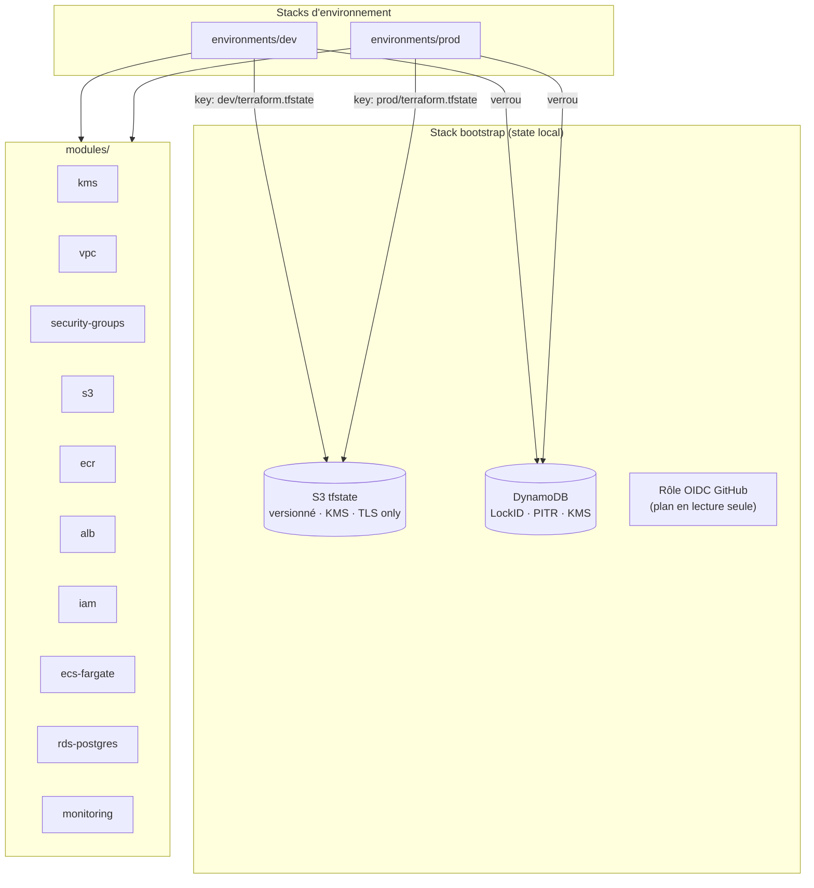
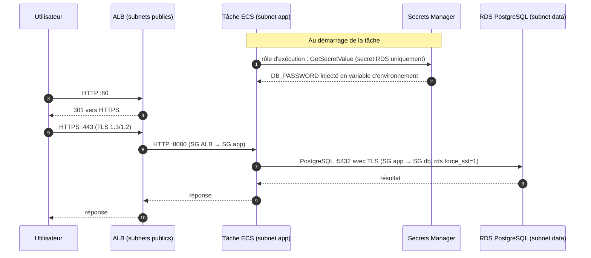
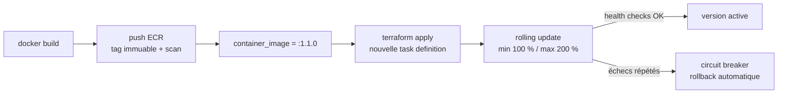

# Architecture

## Vue d'ensemble

La plateforme héberge une application conteneurisée exposée sur Internet, avec une base PostgreSQL privée.
Chaque environnement (`dev`, `prod`) est une **composition** des mêmes modules avec des paramètres différents, dans
son propre state Terraform.



## Réseau

Un VPC `/16` est découpé en trois tiers de subnets `/24`, répartis sur 2 AZ (dev) ou 3 AZ (prod) :

| Tier | CIDR (dev, 10.10.0.0/16) | Contenu | Route par défaut |
|---|---|---|---|
| Public | 10.10.0.0/24, 10.10.1.0/24 | ALB, NAT Gateway | Internet Gateway |
| Privé app | 10.10.10.0/24, 10.10.11.0/24 | Tâches ECS Fargate | NAT Gateway (1 en dev, 1 par AZ en prod) |
| Privé data | 10.10.20.0/24, 10.10.21.0/24 | RDS PostgreSQL | **aucune** (isolé) |

- Le trafic S3 passe par un **gateway endpoint** gratuit : pas de frais NAT, pas de sortie Internet.
- Le **security group par défaut** du VPC est vidé de toutes ses règles (CIS AWS 5.4).
- Les **VPC Flow Logs** (trafic accepté et rejeté) sont envoyés dans CloudWatch Logs, chiffrés par KMS.
- `map_public_ip_on_launch = false`, y compris sur les subnets publics : seuls l'ALB et les NAT ont une IP publique.

## Flux d'une requête



## Déploiement d'une nouvelle version



## Ordre de création et dépendances

Terraform calcule le graphe automatiquement. Quatre dépendances sont rendues explicites via `depends_on` sur des **outputs** de modules :

| Output | Attend | Raison |
|---|---|---|
| `alb.target_group_arn` | listeners HTTP/HTTPS | ECS refuse un target group non attaché à un load balancer |
| `s3.bucket_id` | bucket policy | l'ALB et S3 vérifient leurs droits d'écriture lors de l'activation des logs |
| `vpc.private_app_subnet_ids` | routes NAT | les tâches doivent pouvoir tirer leur image dès leur lancement |
| `iam.*_role_arn` | policies attachées | une task definition ne doit pas démarrer avec un rôle sans permissions |

## Différences dev / prod

| Paramètre | dev | prod |
|---|---|---|
| AZ | 2 | 3 |
| NAT Gateway | 1 partagée | 1 par AZ |
| HTTPS | optionnel | **obligatoire** (validation) |
| Fargate | Spot, 1 à 3 tâches, 0,25 vCPU | On-demand, 3 à 12 tâches, 0,5 vCPU |
| RDS | t4g.micro, single-AZ, backups 1 j | t4g.medium, **Multi-AZ**, backups 30 j, Performance Insights |
| Protection suppression | non (destroy facile) | oui (ALB, RDS, buckets, ECR, snapshot final) |
| Rétention des logs | 14 j | 365 j |
| ECS Exec | activé | désactivé |

## State de la stack bootstrap

La stack `bootstrap` crée le backend : elle ne peut donc pas l'utiliser lors de son premier `apply`. Une fois créée,
son state peut y être migré :

```hcl
# bootstrap/backend.tf
terraform {
  backend "s3" {
    key = "bootstrap/terraform.tfstate"
  }
}
```

```bash
cd bootstrap
terraform init -migrate-state -backend-config=../environments/dev/backend.hcl
```
